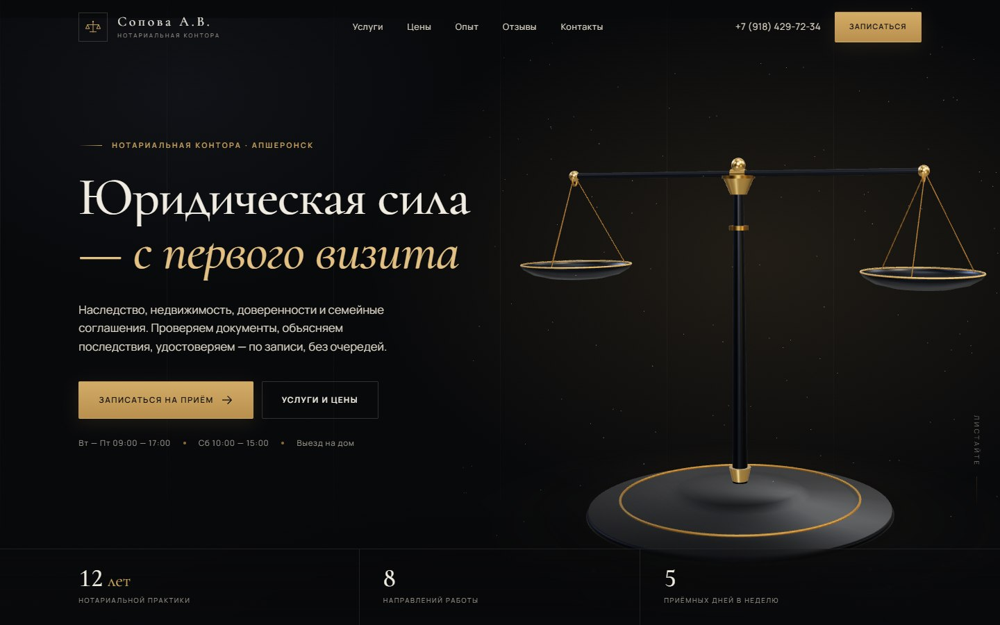

# Нотариальная контора Соповой А.В. — сайт

Одностраничный сайт нотариальной конторы в Апшеронске: тёмная графитовая тема, латунный акцент,
серифная типографика, 3D-весы Фемиды, которые вращаются и «собираются» при прокрутке.

**Стек:** Vite + React + TypeScript, Three.js, GSAP + ScrollTrigger + SplitText, Lenis.
Без UI-фреймворков и готовых шаблонов — вся вёрстка и сцена написаны под проект.

**Опубликованная версия:** https://ler1nes.github.io/sopova-notary/

**Визитка:** [`business-card/`](business-card/) — PDF 90×50 мм с вылетами, PNG-превью
и исходник макета.

Публикация — GitHub Pages: при каждом пуше в `main` GitHub Actions собирает проект и обновляет
сайт. Исходники и workflow — в этом репозитории.

---

## Быстрый запуск

В локальной поставке на Рабочем столе сборка уже лежит в `dist/` — достаточно дважды кликнуть
`start.cmd`. В репозитории сборки нет, её создаёт CI. После клонирования:

```bash
npm ci
npm run build
node scripts/serve.mjs --open   # откроет http://127.0.0.1:4178
```

Для разработки:

```bash
npm ci
npm run dev        # http://127.0.0.1:5178
npm run build      # сборка в dist/
npm run preview    # предпросмотр сборки
npm run typecheck  # проверка типов
```

> В проекте используется сборка через `scripts/build.mjs` (JS API Vite), а не `vite.config.ts`.
> Это сознательное решение: конфиг не бандлится отдельно и сборка не зависит от внешних
> процессов при резолве путей.

---

## Что где менять

| Что | Файл |
| --- | --- |
| Название, телефон, адрес, режим работы | `src/data/site.ts` → `brand`, `contacts` |
| Тексты первого экрана | `src/data/site.ts` → `hero` |
| Услуги и цены | `src/data/site.ts` → `services`, `prices` |
| Опыт, цифры, хронология | `src/data/site.ts` → `practice` |
| Отзывы | `src/data/site.ts` → `reviews` |
| Вопросы и ответы | `src/data/site.ts` → `faq` |
| 3D-сцена (весы) | `src/three/ScalesScene.ts` |
| Анимации появления и параллакс | `src/lib/animations.ts` |
| Стили: токены, компоненты, секции, адаптив | `src/styles/*.css` |
| Карта (координаты и iframe) | `src/data/site.ts` → `contacts.mapEmbed` |

Дизайн-токены — в `src/styles/tokens.css`: палитра (`--ink-*`, `--brass*`), шрифты, отступы,
тайминги. Поменяв 5–6 переменных, можно перекрасить сайт целиком.

---

## Данные и источники

Подтверждено и уже стоит на сайте:

- нотариус **Сопова Альвина Вагинаковна**, лицензия № 638 от 29.10.2014;
- адрес: Апшеронск, ул. Профсоюзная, 43, 1 этаж (перекрёсток с ул. Ленина);
- телефон +7 (918) 429-72-34, Telegram;
- режим: Вт–Пт 09:00–17:00 (обед 12:00–13:00), Сб 10:00–15:00, Вс и Пн — выходной;
- рейтинг Яндекс Карт: **4,3 / 5**, 24 отзыва, 54 оценки;
- ориентиры тарифов по Краснодарскому краю (копии, подписи, завещание, дарение,
  доверенности, согласие супруга, выезд ребёнка).

Источники: [карточка на Яндекс Картах](https://yandex.ru/maps/org/notarius_sopova_a_v_/242807865343/),
[Нотариатус](https://notariatus.ru/apsheronsk/sopova-alvina-vaginakovna),
[totadres](https://totadres.ru/apsheronsk/org/notarius_sopova_a_v/3584275).

## Перед публикацией обязательно проверить

1. **Отзывы.** Тексты в блоке «Отзывы» — демонстрационные. Заменить на реальные (с согласия
   клиентов) или отключить блок. Рейтинг 4,3 / 24 отзыва подтянут с карточки вручную — обновлять
   при изменении.
2. **Цены.** Часть тарифов взята из открытых справочников: подтвердить у нотариуса УПТХ и
   стоимость наследственных дел, купли-продажи, брачных договоров.
3. **Реквизиты.** Добавить ИНН и данные нотариальной палаты, если нужны в подвале.
4. **Политика конфиденциальности.** В модальном окне — шаблон. Заменить на утверждённый текст
   оператора персональных данных.
5. **Форма заявки.** Без бэкенда форма открывает WhatsApp с готовым текстом обращения. Если нужен
   приём заявок на сервер — задайте переменную окружения:

   ```bash
   VITE_LEAD_ENDPOINT=https://example.ru/api/lead
   ```

   Форма отправит `POST` с JSON: `name`, `phone`, `service`, `message`, `source`, `createdAt`.
   Пока переменная не задана, работает резервный сценарий через WhatsApp.
6. **Карта.** Виджет Яндекс Карт с точкой `44.45942, 39.74582` (дом на перекрёстке
   Профсоюзной и Ленина). Карточка организации на Яндекс Картах указывает адрес
   «ул. Ленина, 40» — это тот же дом; если карточку обновят на Профсоюзную, 43, ничего менять
   не нужно. Ссылки — `mapEmbed`, `mapLink`, `orgLink`, `routeLink` в `src/data/site.ts`.
7. **OG-изображение.** `public/og-image.jpg` (1200×630) уже сгенерировано. В `index.html` путь
   относительный — для соцсетей укажите абсолютный URL после деплоя.

---

## Деплой

Любой статический хостинг: `dist/` — это готовый сайт.

- **Nginx/Apache:** положить содержимое `dist/` в корень сайта.
- **Netlify / Vercel / Cloudflare Pages:** команда сборки `npm run build`, каталог `dist`.
- **GitHub Pages:** уже настроен через Actions (`.github/workflows/deploy.yml`). Достаточно
  запушить в `main` — сайт пересоберётся сам. `base: './'` позволяет работать из подпапки
  репозитория.

Сайт не требует сервера приложений: вся логика на клиенте, форма — по желанию через endpoint.

---

## Технические детали

- **3D.** Две сцены: hero и закреплённая секция «Три проверки». Модель собрана процедурно из
  примитивов Three.js (латунь + тёмная сталь), окружение — `RoomEnvironment` + PMREM. Рендер
  останавливается, когда секция вне вьюпорта (`IntersectionObserver`), DPR ограничен 1.8/1.6.
  На экранах ≤1024 px вторая сцена отключается, текстовая часть остаётся статичной.
- **Анимации.** Lenis синхронизирован с `ScrollTrigger`. Заголовки разбиваются `SplitText` на
  строки с масками, блоки появляются по `data-reveal`, цифры считаются через `data-count`.
  Параллакс — атрибут `data-parallax` (значение в пикселях).
- **Доступность.** Семантические секции и заголовки, skip-link, фокус-стили, `aria-expanded` у
  аккордеонов и меню, `aria-selected` у табов, закрытие меню и модалок по Escape, поддержка
  `prefers-reduced-motion` (полностью отключает анимации и 3D-скролл, оставляя статичную сцену).
- **Производительность.** Шрифты self-hosted (Fontsource, кириллица), Three.js грузится
  динамическим импортом отдельным чанком, карта — lazy iframe, изображений почти нет.
- **Совместимость.** Chrome/Edge/Firefox/Safari последних версий, iOS 15+, Android Chrome.

---

## Структура

```
src/
  components/     Header, Hero, Services, Principles, Prices, Reviews, Contacts, ContactForm…
  data/site.ts    весь контент и контакты
  lib/            анимации, форматирование чисел
  styles/         tokens, components, sections, responsive
  three/          процедурная модель весов и сцена
  App.tsx         сборка страницы, Lenis, якоря, состояние меню и модалки
scripts/
  build.mjs       сборка (Vite JS API)
  dev.mjs         dev-сервер
  serve.mjs       статический сервер для dist (+ флаг --open)
  og.mjs          генерация OG-изображения
public/           favicon, og-image
```

---

## Скриншоты

| Desktop | Mobile |
| --- | --- |
|  |  |
